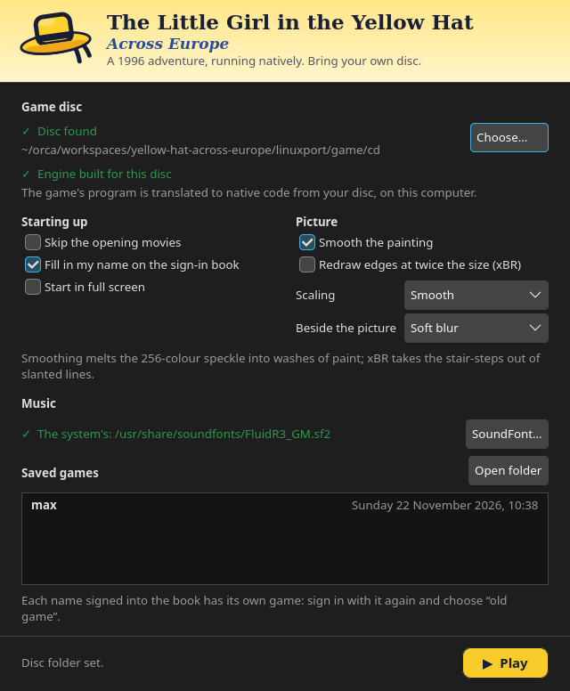
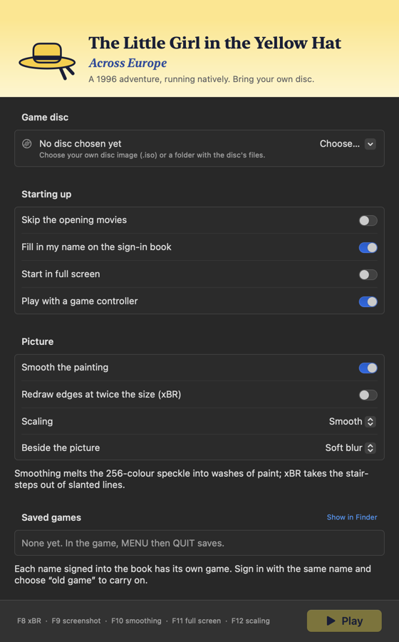

<p align="center"></p>

# The Little Girl in the Yellow Hat Across Europe

**Madeline: European Adventures** (Creative Wonders, 1996), running as a native
app on modern computers. No emulators, no messing around with a lot of settings.

**[Download the latest release](https://github.com/prasys/yellow-hat-across-europe/releases/latest)**
for Windows, macOS or Linux, then point it at your own copy of the game.

## Why I made this

When I was a kid I played this game and it really helped me understand
different cultures, and a lot more. So I thought, why don't we preserve it, so
people can share it with their whanau (family) and their kids, running on
modern hardware.

The game's own program (`MADEURO.EXE`, a 148 KB Win32s/WinG executable) is
statically recompiled to C with [pcrecomp](https://github.com/sp00nznet/pcrecomp)
and linked against a small host that plays the part of Windows 95: a 640x480
256-colour screen, WinG, waveOut sound and MIDI music. You can download a
ready-made build, or make that build yourself from your own disc.

## Where to get the game

**You need your own copy of the game.** This repository contains no game code,
art or sound, and neither does the program it builds: the lift is made on your
machine from your disc, and the game reads its art and sound straight from your
disc while it runs.

The game has been out of print for decades. Any one of these will do:

- **A disc you already own.** Make an ISO of it (on a Mac, Disk Utility, then
  File > New Image > Image from the disc). The app takes that file as it is,
  and so does `make extract` below. This is the cleanest route.
- **A second-hand disc.** Copies turn up on eBay and in charity shops. Same
  steps once it arrives.
- **An abandonware copy.** An image is listed at
  [Old Games Download](https://oldgamesdownload.com/game/madeline-european-adventures-u9z/)
  (the Windows ISO, English). This project is not connected with that site.
  Abandonware is not a licence: the copyright still belongs to its owners, so
  a copy you own is the honest way to run it.

Once built, the app is for your own machine only. It contains code made from
your copy of the game, so please do not pass it on.

## Downloads

The easy way to play: download a release from the
[releases page](https://github.com/prasys/yellow-hat-across-europe/releases/latest)
and pick the file for your computer. The current release is v01.

### On Windows 10/11 (64-bit)

Download `Yellow_Hat_Across_Europe-windows-x86_64.zip` (92 MB), then extract
all of it. Run `Yellow Hat Across Europe.exe` from the extracted folder, not
from inside the zip.

Windows will say the publisher is unknown, because the app is not signed:
choose More info, then Run anyway.

Settings and saves are in `%APPDATA%\MadelineEuropeanAdventures`.

### On a Mac (macOS 13 or later, Apple silicon)

Download `Yellow_Hat_Across_Europe-macos-arm64.dmg` (117 MB). Open it and drag
the app to Applications.

Apple has not signed the app, so macOS blocks the first open. Go to System
Settings, then Privacy & Security, scroll down, then Open Anyway.

There is no Intel Mac build.

Saves are in `~/Library/Application Support/MadelineEuropeanAdventures`.

### On Linux (x86-64 or aarch64)

Download the AppImage for your CPU:
`Yellow_Hat_Across_Europe-x86_64.AppImage` (about 120 MB) or
`Yellow_Hat_Across_Europe-aarch64.AppImage` (about 112 MB). It needs glibc 2.39
or newer, which means Ubuntu 24.04, Fedora 40 and later.

Make it executable, then run it:

```sh
chmod +x Yellow_Hat_Across_Europe-x86_64.AppImage
./Yellow_Hat_Across_Europe-x86_64.AppImage
```

Your file manager does the same through "Allow executing as program".

Music needs a General MIDI SoundFont installed, for example `soundfont-fluid`
or `fluid-soundfont-gm`. Without one, the game plays silently.

Saves are in `~/.local/share/madeline-european-adventures`.

### Your first run, on every system

None of these files holds any of the game. Open the app and choose your own
disc image, either the `.iso` or the `.zip` it was downloaded in. The app
unpacks it and translates the game's program on your computer, which takes a
minute or two the first time and again after an app update. Then press Play.
Nothing else needs installing: the app carries its own Python and the zig C
compiler, and the translated engine lives in the data folder (`engine/` beside
the saves), not inside the app.

The engine is built from your disc, so it is for your own machine. Do not pass
the data folder on.

### What has been tested

Linux was run end to end with a real disc: the AppImage, built in an Ubuntu
24.04 container as CI builds it, was opened on CachyOS, pointed at a downloaded
`.zip`, unpacked the disc, built the engine in under a minute and reported it
ready. That engine reaches the main menu headless.

Windows and macOS were each built, and their engine selftested, on a real
Windows and a real Mac runner in CI. Neither has been played with a real disc
yet.

If you would rather build it from source, the steps below do that.

## What you need

To download a release, you need a copy of the game, as above, and a computer
with one of the systems listed in Downloads.

To build it from source, you also need:

- A Mac on macOS 13 or later (Apple silicon or Intel), a Windows 10/11 PC
  (64-bit), or a Linux PC (x86-64).
- About 700 MB free for the unpacked disc, plus room for the build.
- A terminal. On the Mac that is Terminal; on Windows it is the MSYS2 shell;
  on Linux, any terminal. Copy the commands below one at a time.

## Build it on a Mac

**1. Install the libraries.** Homebrew does it in one line. `uv` is optional:
without it the lift makes its own `python3 -m venv`.

```sh
brew install sdl2 sdl2_ttf uv
```

**2. Get the code and its one submodule**, which is the recompiler:

```sh
git clone https://github.com/prasys/yellow-hat-across-europe.git
cd yellow-hat-across-europe
git submodule update --init
```

**3. Unpack your disc, once.** Point `ISO=` at your own image:

```sh
make extract ISO=/path/to/your/Madeline_European_Adventures.iso
```

The disc's files land in `game/cd/`, which git ignores. If you already have
them in a folder, skip this step and use `make CD=/that/folder` and
`build/madeline /that/folder`.

**4. Build the game.** This lifts `MADEURO.EXE` and compiles it, about fifteen
seconds on a recent Mac:

```sh
make                                   # lifts MADEURO.EXE, builds build/madeline
```

**5. Open the app.**

```sh
make launch                            # the app: settings and a Play button
```

`make launch` builds `build/The Little Girl in the Yellow Hat Across Europe.app`
and opens it. `make run` starts the game directly instead.

## Build it on Windows 10/11 (64-bit)

The same program builds on Windows with [MSYS2](https://www.msys2.org/). Install
it from that page, then open **MSYS2 UCRT64** from the Start menu. Every command
below goes in that shell.

**1. Install the build tools and libraries.**

```sh
pacman -S --needed make git diffutils mingw-w64-ucrt-x86_64-gcc \
  mingw-w64-ucrt-x86_64-pkgconf mingw-w64-ucrt-x86_64-SDL2 mingw-w64-ucrt-x86_64-SDL2_ttf \
  mingw-w64-ucrt-x86_64-python mingw-w64-ucrt-x86_64-python-capstone
```

**2. Get the code and its one submodule.**

```sh
git clone https://github.com/prasys/yellow-hat-across-europe.git
cd yellow-hat-across-europe
git submodule update --init
```

**3. Unpack your disc, once.** MSYS2 paths start at the drive, so a file on
your Desktop is `/c/Users/you/Desktop/...`:

```sh
make extract ISO=/c/Users/you/Desktop/Madeline_European_Adventures.iso
```

**4. Build it.**

```sh
make                                   # lifts MADEURO.EXE, builds build/madeline.exe
```

**5. Open the launcher.**

```sh
make launch                            # the launcher: settings and a Play button
```

`make launch` builds the folder `build/app` and opens
`Yellow Hat Across Europe.exe` in it: the launcher, with the engine and the
DLLs it needs beside it, so it also starts from Explorer. It can unpack a
disc image itself (Windows mounts it) and rebuilds the engine for a
different disc through the MSYS2 it was built with. `make run` starts the
game directly instead, from the MSYS2 shell. Settings and saves are in
`%APPDATA%\MadelineEuropeanAdventures`; what the game printed on its last
run from the launcher is in `last-run.log` there. As on the Mac, `build/app`
contains code made from your copy of the game: do not pass it on.
([brief 05](docs/briefs/05-windows-build.md) has what is left.)

## Build it on Linux (x86-64)

**1. Install the build tools and libraries.** FluidSynth and a SoundFont play
the music; GTK 4 draws the launcher.

```sh
# Arch, CachyOS, Manjaro:
sudo pacman -S --needed base-devel git sdl2 sdl2_ttf fluidsynth soundfont-fluid gtk4 python 7zip
# Debian, Ubuntu:
sudo apt install build-essential git pkg-config libsdl2-dev libsdl2-ttf-dev \
  libfluidsynth-dev fluid-soundfont-gm libgtk-4-dev python3-venv 7zip
```

**2. Get the code and its one submodule.**

```sh
git clone https://github.com/prasys/yellow-hat-across-europe.git
cd yellow-hat-across-europe
git submodule update --init
```

**3. Unpack your disc, once.**

```sh
make extract ISO=/path/to/your/Madeline_European_Adventures.iso
```

**4. Build it.**

```sh
make                                   # lifts MADEURO.EXE, builds build/madeline
```

**5. Open the launcher.**

```sh
make launch                            # the launcher: settings and a Play button
make desktop                           # optional: put it in your desktop's menu (make undesktop removes it)
```



`make launch` builds the folder `build/app` and opens the launcher in it: the
same window as on the Mac and Windows. It unpacks a disc image itself (with
7z or bsdtar), rebuilds the engine for a different disc through this
checkout, shows which SoundFont the music will use and lets you choose
another, and lists the saved games. `make run` starts the game directly
instead. What the game printed on its last run from the launcher is in
`last-run.log` beside the saves. As on the other systems, `build/app`
contains code made from your copy of the game: do not pass it on.

Saves and settings are in `~/.local/share/madeline-european-adventures/`
(`$XDG_DATA_HOME`). The packages above install a General MIDI SoundFont where
it is looked for; any other `.sf2` can be named with `soundfont=` in
`madeline.ini`. Without FluidSynth or a SoundFont the game plays with its
speech and effects and no music (it says so once at start). SDL draws on
Wayland itself when it can; `SDL_VIDEODRIVER=x11` runs it through XWayland
instead. arm64 Linux should build the same way (CI builds it); the game has
not been played on one.

## Playing

- The mouse does everything; the sign-in book takes your name from the keyboard
  (or from one drawn on the screen: see below).
- **Enter** (or Esc) stops the movie that is playing. `--skip-intro` does that
  for the two opening movies by itself.
- **Saving happens in one place only: MENU (bottom right of a scene), then
  QUIT.** There is no save key, and Esc does nothing inside a scene. Closing
  the window instead makes the game ask "Exiting this way will NOT save your
  game... are you sure?".
- Each name signed into the book has its own saved game (ten at most), found
  by the exact name: the game never lists them. To make carrying on easy, the
  name you last saved under is typed into the book for you. Click the red
  arrow, then "old game". Backspace clears it if you want another name.
- **A game controller** plays it too (any pad SDL knows: Xbox-style, the
  Steam Deck's). The left stick or the cross moves the pointer, the right
  stick moves it slowly for small targets, **A** (or the right trigger) is
  the mouse button, **B** is Esc, **Start** is Enter (stops a movie),
  **Back** is full screen. Plug it in before or while playing.
- **No keyboard?** With a controller or a touch screen, a keyboard is drawn
  on the screen when the sign-in book opens: press its keys with A or a
  finger. On the pad the cross steps from key to key, **B** is Backspace,
  **X** is Shift, **Start** continues, **Y** closes and opens the keyboard.
  Its bottom-left keys hide it and move it to the top of the screen.
  Pressing a real key puts it away.
- **F8** turns xBR edge redrawing on and off (see Picture modes).
- **F10** turns picture smoothing on and off, **F11** full screen, **F12**
  cycles the scaling (smooth, sharp, CRT, ...). These are remembered.
  **F9** saves a screenshot (to `screenshots/` beside the saves).
- **Printing.** The Print button on the painting screen asks "Would you like to print?" as it always did. Yes makes a PDF of the
  picture in `prints/` beside the saves and, on a Mac, opens the system
  print dialog for it: pick a printer there, or its PDF menu to save a copy
  somewhere else. On Windows and Linux the PDF is opened in your PDF viewer,
  to print from there.
- Saved games are kept in
  `~/Library/Application Support/MadelineEuropeanAdventures/CWONDERS/MADEURO/`
  (Linux: `~/.local/share/madeline-european-adventures/CWONDERS/MADEURO/`).

Options: set them in the launcher, or on the command line, or in
`madeline.ini` in `~/Library/Application Support/MadelineEuropeanAdventures/`
(the launcher and the game both read and write that file):

| Command line | `madeline.ini` | |
|---|---|---|
| `--skip-intro` | `skip_intro=1` | Go straight to the main menu |
| `--fullscreen` | `fullscreen=1` | Start full screen |
| | `remember_name=0` | Do not type the last saved name into the sign-in book |
| | `smooth=0` | Show the original pixels: no melting of the 256-colour dithering (F10) |
| | `upscale=xbr` | Redraw edges at twice the size before scaling: slanted ink lines lose their stair-steps (F8). Off by default |
| | `scale=sharp` | Scaling to the window: `smooth` (default), `sharp`, `crt`, `nearest`, `integer` (F12) |
| | `gamepad=0` | Ignore game controllers |
| | `pointer=game` | The game's own pointers, which change shape over things you can click (the girl, arrows over doors). By default a plain arrow everywhere |
| | `bars=black` | Black beside the picture when full screen, instead of a blur of it |
| *path* | `cd=/path` | The folder with the disc's files |
| | `soundfont=/path/to.sf2` | Linux: the SoundFont the music is played with (else a system one is looked for) |

```sh
build/madeline --skip-intro game/cd
```

## The app



One window: choose your disc, set how the game starts and looks, see your
saved games, press Play. Its icon and the hat in its header are drawn by the
project (`launcher/make_icon.swift`); nothing in it comes from the game.

### What happens when you choose a disc

The game's program cannot be shipped, so it is made on your Mac from your disc.
Choosing a disc image sets this off, in the folders shown:

| Step | What | Where it goes |
|---|---|---|
| 1. Unpack | The `.iso` is unpacked with the system's `bsdtar`. (A folder you chose is used where it is.) | `~/Library/Application Support/MadelineEuropeanAdventures/disc/` |
| 2. Check | The engine is asked whether it was built from this disc's `MADEURO.EXE` (`madeline --check`). If yes, stop here. | |
| 3. Lift | pcrecomp translates `MADEURO.EXE` (148 KB of 1996 x86 code) into C: 932 functions. | `build/gen/` in the source checkout |
| 4. Compile | That C is compiled and linked with the host (`src/`) and pcrecomp's Win32 layer into the engine. | `build/madeline`, then copied into the app |
| 5. Play | The engine reads the art, sound and scripts straight from the unpacked disc. | saves in `.../MadelineEuropeanAdventures/CWONDERS/MADEURO/` |

Steps 3 and 4 take about fifteen seconds and only happen for a disc the engine
was not already built for; the window shows "Engine built for this disc" when
it is ready. They need the source checkout the app was built from (the app
remembers where that is), the Xcode command-line tools and Homebrew's SDL2.
Because the app then contains code made from your copy of the game, it is
for your own machine: do not pass it on.

### Ways to run it, in one line each

| | |
|---|---|
| `make launch` | Build the app and open it: settings, saved games, Play. |
| `make run` | Build and start the game directly, with the settings last saved. |
| `build/madeline --skip-intro game/cd` | Straight to the main menu. |
| `build/madeline --fullscreen game/cd` | Full screen (`--windowed` for a window). |
| `build/madeline --check game/cd` | Only say whether this engine was built for that disc (exit 0 yes, 3 no). |
| `make CD=/other/disc` | Rebuild the engine for a different disc folder. |
| `scripts/playtest.sh OUT "SCRIPT"` | No window, fast-forwarded, scripted clicks and screenshots: for testing. |

### Picture modes, in one line each

**Smoothing** (F10, `smooth=`): on, the 256-colour speckle is melted into flat
washes of paint and ink lines are kept; off, you see the original pixels.

**xBR** (F8, `upscale=xbr`): off, the 640x480 picture goes to the scaling
below as it is; on, it is first doubled to 1280x960 by Hyllian's xBR rule,
which finds diagonal edges and redraws them smooth. Characters and ink
outlines gain the most; painted backgrounds lose a little brush texture. It
comes after smoothing and works with or without it. Screenshots (F9) are of
the doubled picture while it is on.

**Scaling** (F12, `scale=`) is how the 640x480 picture is enlarged to the window:

| Mode | |
|---|---|
| `smooth` | Soft, anti-aliased enlargement. The default; best with smoothing on. |
| `sharp` | Crisp pixel edges: enlarged in whole steps first, then blended only for the remainder. |
| `crt` | `sharp`, with the dark scan lines of an old glass monitor. |
| `nearest` | Every pixel a hard square: exactly the original, blocky. |
| `integer` | Like `nearest`, but only at whole multiples (2x, 3x), with a border around it. |

**Beside the picture** (`bars=`): `blur` fills the sides of a wide screen with
a soft blur of the picture; `black` leaves them black.

## What works

Played by hand in a window and found working. Checked by scripted
play-throughs (see Testing): start-up, both opening movies,
the main menu, sign-in, the options screen, a new game through its opening into
the Paris station, clicking around a scene, quitting with a save, and loading
that save with "old game". Sound effects, speech and movie soundtracks play
through SDL; the MIDI music plays through macOS's built-in synthesizer.
On Windows 11 the same play-throughs pass and the game has been started in a
window and looked and listened to once (2026-11-17), through Windows' own
MIDI synthesizer; it has had far less play there than on the Mac.
On Linux (CachyOS, x86-64, Wayland; 2026-11-21) the lift builds and the same
headless play-throughs pass: start-up, menu, sign-in, a new game to the Paris
station, quitting with a save, and "old game" from it. A window opens on
Wayland. The MIDI music through FluidSynth has been checked by its traces
(loaded, played, its end reported to the game) but not yet listened to, and
nobody has played the Linux build by hand yet.

Printing (2026-11-21): a scripted play-through paints a picture, presses
Print and gets a PDF that matches the screen; the Mac's print dialog has been
seen to open over an SDL window but has not been driven by a person from
inside the game, and the Windows and Linux hand-over (opening the PDF) has
not been run at all.

Game controller and on-screen keyboard (2026-11-21): scripted play-throughs
drive the pointer with a pretend pad, sign in with it and with taps on the
keyboard drawn over the book, and reach the options screen. No real
controller or touch screen has been tried yet, on any system.

The releases (2026-11-22): v01 is out, with the Windows zip, the macOS dmg and
the two Linux AppImages. The Linux AppImage, built in an Ubuntu 24.04 container
exactly as CI builds it, was run on CachyOS: pointed at the downloaded `.zip`,
its launcher unpacked the disc, built the engine with the bundled kit in under a
minute and showed it ready, and that engine boots to the main menu headless
(`tests/game.sh`). The Windows zip is cross-built on Linux and selftested on a
real Windows runner; the macOS dmg is built and selftested on a Mac runner.
Neither of those two has been played with a real disc.

Known gaps: only the first scene and the activities' first screens have been played by the
tests. [docs/ROADMAP.md](docs/ROADMAP.md) lists everything still to build.

## Where this is going

The next big thing I want is the game on a tablet: iPads and iPhones, and
Android tablets. The picture is 4:3 and the mouse is nearly all the game asks
for, which suits a touch screen. Two pieces are already in: `src/osk.c` draws a
keyboard on the screen for the sign-in book when there are no real keys, and
`src/pad.c` already tells a finger tap from a mouse click. What is missing is
real hardware to try it on, and a way to build the game for those devices.

A tablet with a game controller is the shortest road to playing on one today,
because a controller works and a touch screen has never been near it.

The order I want to take these in is in [docs/ROADMAP.md](docs/ROADMAP.md).

## How it works

```
your disc ──extract──> game/cd/MADEURO.EXE ──pcrecomp──> build/gen/*.c  (932 functions)
                                                              │
        src/*.c (this repo) + pcrecomp's win32hle runtime ────┴──> build/madeline
```

| File | What it does |
|---|---|
| `src/main.c` | Maps your disc as `D:`, a folder in your home as `C:`, boots the image |
| `src/gfx.c` | The display: GDI + `WING32.DLL` on a palette-indexed 640x480 screen, so palette fades and colour cycling work as on 256-colour Windows; smooths the dithering; draws the mouse pointer |
| `src/xbr.c` | The optional xBR doubling of the picture |
| `src/print.c` | The printer: the game's one printed page, kept as a PDF. `src/mac/print_mac.m` puts the Mac's print dialog on it |
| `src/audio.c` | `waveOut` on SDL audio, with buffers reported done when actually heard (the game times animation by it); MCI for the music |
| `src/midi.c` | Standard MIDI Files on AudioToolbox; on Linux, FluidSynth into SDL's audio |
| `src/win/` | Windows only: the POSIX calls pcrecomp's Win32 layer makes, on the Windows API; MIDI on MCI; opening a printed PDF |
| `src/platform.c` | Where the player's files live on each system |
| `src/shims.c` | The CD-ROM drive check, the installer's registry entry, the clock, the window's size |
| `src/pad.c` | A game controller as the mouse and a few keys; tells mouse-and-keys, touch and pad apart |
| `src/osk.c` | The keyboard drawn on the screen for the sign-in book, when there are no real keys |
| `src/debug.c` | A script driver for tests; screenshots |
| `launcher/` | The macOS app: a SwiftUI settings window and Play button around the engine. `launcher/win/`: the same window on Win32; `launcher/linux/`: on GTK 4 |
| `third_party/pcrecomp` | The recompiler and the Win32 layer (submodule) |

[docs/NOTES.md](docs/NOTES.md) has what was learned about the executable;
[AGENTS.md](AGENTS.md) is the guide for anyone (or any agent) changing the code.

## Testing

```sh
make lint      # warnings as errors in src/ and the launcher, clang-tidy, shellcheck, ruff
make test      # the kit's tests, the engine's start and its agreement with the kit;
               # with the game in game/cd, also a boot to the main menu
```

Both run in CI (`.github/workflows/build.yml`) on every system, without the
game. Lint tools that are not installed are skipped locally (`LINT_STRICT=1`
makes that an error, as in CI).

`scripts/playtest.sh` runs the game headless with its clock sped up, feeds it
clicks and keys, and writes screenshots plus a contact sheet:

```sh
scripts/playtest.sh /tmp/out "68000 click 320 280; 100000 type MAX; 112000 click 560 440; 150000 shot menu.bmp; 151000 quit"
```

Times are milliseconds on the game's clock. Useful switches when something
breaks: `MADELINE_TRACE=1` (every Win32 call), `HLE_FILETRACE=1` (file opens),
`MADELINE_GFXTRACE=1`, `MADELINE_AUDIOTRACE=1`. `scripts/dis.sh 405b90 405c10`
prints the original instructions for an address range from the lift.

## Credits

Recompiler and Win32 runtime: [sp00nznet/pcrecomp](https://github.com/sp00nznet/pcrecomp) (MIT).
Madeline: European Adventures is the work of Creative Wonders and Vortex Media
Arts; Madeline is a trademark of its owners. This project is not affiliated
with them.
